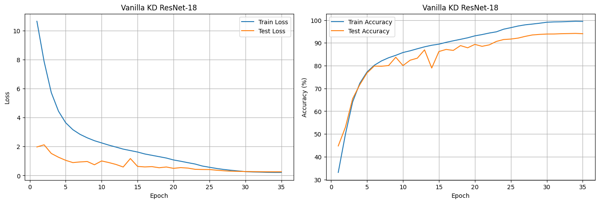
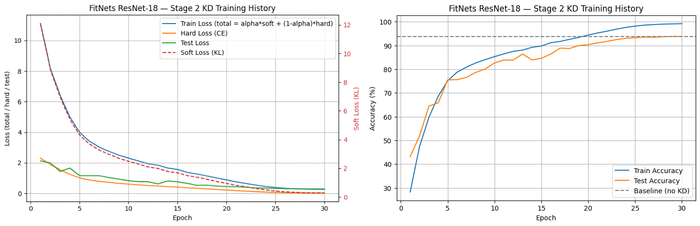
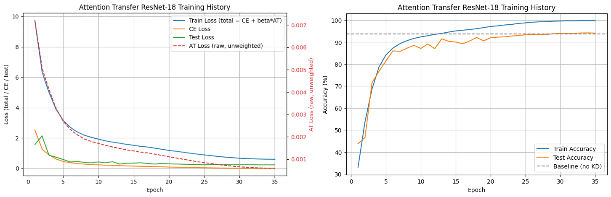

# Comparative Study of Knowledge Distillation Algorithms

A controlled comparison of three representative knowledge distillation (KD) methods — **Vanilla KD** (logit-based), **FitNets** (feature-based) and **Attention Transfer** (attention-map-based) — trained under the same setup so that differences come from the distillation algorithm alone.

**Teacher:** ResNet-34 → **Student:** ResNet-18 | **Dataset:** CIFAR-10 | **Framework:** PyTorch | **Hardware:** Google Colab (NVIDIA T4)


---

## Abstract

This work presents a controlled comparative study of three representative knowledge distillation algorithms: Vanilla KD (logit-based), FitNets (feature-based), and Attention Transfer (attention-map-based). Using ResNet-34 as the teacher and ResNet-18 as the student on CIFAR-10, we fix the architectures, dataset and training protocol so that performance differences can be attributed to the distillation method itself, rather than to heterogeneous experimental setups. Each distilled student is compared against a ResNet-18 baseline trained without distillation.

---

## Why Knowledge Distillation?

A large **teacher** network is accurate but expensive to run. KD trains a small **student** to imitate the teacher, so it reaches higher accuracy than the same student trained on hard labels alone, with no extra inference cost. The three methods differ in *what* the student imitates:

| Method | What the student mimics | Signal source |
|---|---|---|
| **Vanilla KD** (Hinton et al., 2015) | The teacher's softened output probabilities | Final logits |
| **FitNets** (Romero et al., 2015) | The teacher's intermediate feature maps ("hints") | A hint layer, matched through a learned regressor |
| **Attention Transfer** (Zagoruyko & Komodakis, 2017) | *Where* the teacher looks — spatial attention maps | Activations of intermediate blocks |

### Loss functions

**Vanilla KD**

```
L = α · T² · KL( softmax(z_t / T) ‖ softmax(z_s / T) ) + (1 − α) · CE(z_s, y)
```

Temperature `T` softens the distributions so the student sees the teacher's relative class similarities. The `T²` factor keeps gradient magnitudes comparable as `T` changes.

**FitNets** — two stages

1. *Stage 1 (hint training):* a regressor maps a student intermediate layer to the shape of the teacher's hint layer; train with MSE so the student's early layers learn useful features.
2. *Stage 2 (KD):* train the full student with the KD loss above, starting from the Stage-1 weights.

**Attention Transfer**

```
A(F)  = Σ_c |F_c|^p            (collapse channels into one spatial map)
Â(F)  = A(F) / ‖A(F)‖₂         (flatten + L2-normalise)
L     = CE(z_s, y) + β · Σ_layers ‖ Â(F_s) − Â(F_t) ‖_p
```

Because attention maps collapse the channel dimension, no regressor is needed.

---

## Experimental Setup

| Item | Value |
|---|---|
| Teacher | ResNet-34 (trained first, then frozen) |
| Student | ResNet-18 |
| Dataset | CIFAR-10 |
| Baseline | ResNet-18 trained on hard labels only (no KD) |
| Epochs | Vanilla KD: 35 · FitNets Stage 2: 30 · Attention Transfer: 35 |
| Hardware | Google Colab, NVIDIA T4 |

Teacher, architecture, dataset and evaluation are identical across methods; only the distillation loss changes.

---

## Results

### Training curves

Each figure shows loss (top) and accuracy (bottom) per epoch. The dashed grey line in the accuracy plots is the no-KD student baseline.

**Vanilla KD**



**FitNets (Stage 2)**



**Attention Transfer**



### Accuracy summary

Test accuracy at the final epoch, read from the training curves.

| Model | Test accuracy (%) |
|---|---|
| Student baseline — ResNet-18 (no KD) | ≈ 93.7 |
| Vanilla KD | ≈ 94.2 |
| FitNets | ≈ 94.0 |
| Attention Transfer | ≈ 94.0 |

All three KD students share the ResNet-18 architecture, so **inference cost is identical** to the baseline; KD only changes how the student is trained.

---

## How to Read the Training Plots

**Loss plots**

- **Train Loss (total)** — the full objective the optimizer minimises:
  - Vanilla KD / FitNets: `α·soft + (1−α)·hard`
  - Attention Transfer: `CE + β·AT`

  It starts high (≈ 10) mainly because the distillation term is large early on, and decays steadily.
- **Hard Loss / CE Loss** — plain cross-entropy against the true labels; much smaller than the total.
- **Soft Loss (KL)** (right axis, Vanilla KD / FitNets) — divergence between student and teacher distributions; goes to ≈ 0 as the student matches the teacher.
- **AT Loss (raw, unweighted)** (right axis, Attention Transfer) — attention-map distance *before* multiplying by β. It is on a tiny scale (~10⁻³), hence its own axis and a large β.
- **Test Loss** — plain cross-entropy on the test set. It is not comparable to the training total (which includes the distillation term); compare it with the CE / hard loss.

**Accuracy plots**

- **Train / Test Accuracy** per epoch. The gap between them (train ≈ 99–100 %, test ≈ 94 %) is the student's generalisation gap.
- **Baseline (no KD)** — final test accuracy of ResNet-18 trained without a teacher. A KD method helps if its test curve ends above this line.

---

## Key Observations

- **All three methods finish slightly above the no-KD baseline** (≈ 94 % vs ≈ 93.7 %). The gain is under one percentage point, which is typical when the baseline student is already strong on CIFAR-10.
- **The three KD methods are within a few tenths of a percent of each other**, comparable to run-to-run noise for a single run, so these results do not establish a ranking between them.
- **Convergence speed differs more than final accuracy.** Attention Transfer climbs fastest in the early epochs; Vanilla KD shows the most pronounced mid-training dip in test accuracy before the learning rate decays.
- **All students fit the training set almost perfectly** (≈ 99–100 % train accuracy), so the remaining gap is a generalisation gap, not an optimisation one.
- **Training cost differs by method:** Vanilla KD needs only the teacher's logits; FitNets adds a regressor and a separate Stage-1 pass; Attention Transfer needs intermediate activations (hooks) but no extra learnable module.

---
